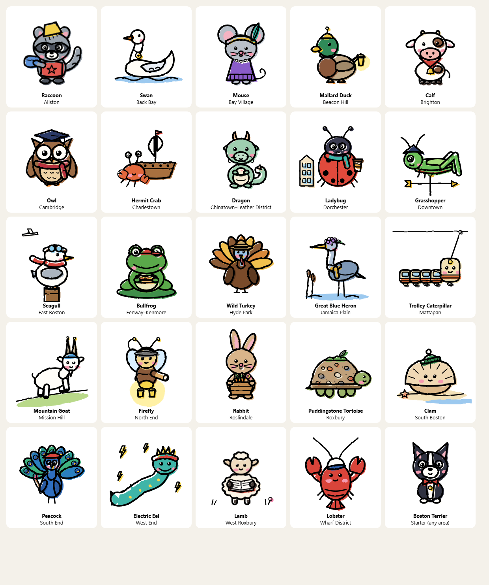

# Area pets

One pet per map area (the 24 areas in `src/lib/mock/neighborhoods.json`), plus a Boston Terrier starter. Pets have no preset names: they are called by their animal, and users give them nicknames.



## Files

| Path | What |
|---|---|
| `pets.json` | One entry per pet: `areaId` (matches the neighborhood `id`), `area`, `areaColor`, `animal`, `png`, `svg`, `starter` |
| `png/<areaId>.png` | 512×512 transparent PNG |
| `svg/<areaId>.svg` | The same art as SVG |
| `contact-sheet.png` | All pets on one page |

Vite serves this folder at `/pets/`, so `png` and `svg` in `pets.json` are ready to use as image URLs (for example `/pets/png/wharf-district.png`). The starter's `areaId` is `starter`.

## Pets by area

| Area | Pet |
|---|---|
| Allston | Raccoon |
| Back Bay | Swan |
| Bay Village | Mouse |
| Beacon Hill | Mallard Duck |
| Brighton | Calf |
| Cambridge | Owl |
| Charlestown | Hermit Crab |
| Chinatown–Leather District | Dragon |
| Dorchester | Ladybug |
| Downtown | Grasshopper |
| East Boston | Seagull |
| Fenway–Kenmore | Bullfrog |
| Hyde Park | Wild Turkey |
| Jamaica Plain | Great Blue Heron |
| Mattapan | Trolley Caterpillar |
| Mission Hill | Mountain Goat |
| North End | Firefly |
| Roslindale | Rabbit |
| Roxbury | Puddingstone Tortoise |
| South Boston | Clam |
| South End | Peacock |
| West End | Electric Eel |
| West Roxbury | Lamb |
| Wharf District | Lobster |
| Starter (any area) | Boston Terrier |

## Changing a pet

The art is drawn in code in `scripts/pets/pets.html` (one `pet(...)` block per area). Edit it, then rebuild everything here with:

```sh
bash scripts/pets/build.sh
```

The build needs Google Chrome (it renders headlessly) and perl, which comes with Git Bash. You can also open `scripts/pets/pets.html` in a browser to see every pet at once.
